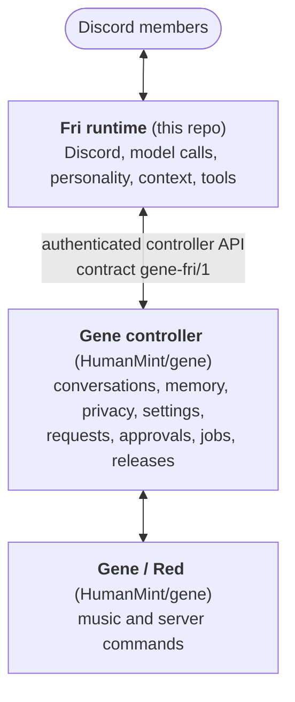

# Fri

Fri is a Discord companion bot: a deadpan, slightly sassy regular in your server who turns earnest and
useful when someone's working on something. Fri uses they/them. They answer when named, mentioned or
replied to, read the room (recent history, images, replies, threads, pins, links), react now and then,
keep small notes members can see and erase, look things up, set reminders, and hand music and server
commands to [Gene](https://github.com/HumanMint/gene).

This repository is Fri's runtime. Everything that has to last (conversations, memory, privacy,
settings, approvals) lives in Gene's controller, which Fri reaches over an authenticated, versioned API.



<details>
<summary>Plain-text version</summary>

```text
Discord members
      ↕
Fri runtime (this repo): Discord, model calls, personality, context, tools
      ↕  authenticated controller API (contract gene-fri/1)
Gene controller (HumanMint/gene): conversations, memory, privacy, settings, requests, approvals, jobs, releases
      ↕
Gene / Red (HumanMint/gene): music and server commands
```

</details>

**Try it in your own server:** [docs/quickstart.md](docs/quickstart.md) walks through running Fri and a
local Gene controller against a test server you own.

## Quickstart

You need `git`, [`uv`](https://docs.astral.sh/uv/getting-started/installation/), a Discord bot
application for Fri, a test server, and a ChatGPT plan that can sign Fri in (Fri has no API-key
mode; [details](docs/quickstart.md#what-you-need)). With a local Gene controller running (step 2 of the
quickstart):

```sh
scripts/local.sh setup                               # venv, a private .env.local, then a config check
$EDITOR .env.local                                   # fill in what the check lists as missing
uv run --no-sync python scripts/connect_chatgpt.py   # sign Fri in to your ChatGPT plan
scripts/local.sh check --controller                  # validate, read the controller's contract, print an invite link
scripts/local.sh run                                 # start Fri
```

The check never prints a token, and `.env.local`, `.state/` and `.secrets/` are git-ignored. A fresh
controller starts with Fri switched off; [step 7](docs/quickstart.md#7-say-hi) shows how to turn them on.

## How it fits together

- **Fri runtime** (`src/fri/`, Python 3.11, discord.py): the Discord client, model calls, Fri's voice,
  context gathering, tools and background attention. It has no database: its data directory holds only
  a health file, receipts waiting for the controller, small status state and a run lock.
- **Gene controller** ([HumanMint/gene](https://github.com/HumanMint/gene), FastAPI + SQLite): stores
  conversations and memory, enforces privacy, scope and allowances, and owns settings, member requests,
  owner approvals, jobs and releases. Gene is the only deployment authority.
- **Gene / Red**: Gene's Red-DiscordBot cogs. Fri queues music and status commands for it through the
  controller's audited command catalog; Red's member, voice and DJ checks still apply.
- **The contract.** Every call carries `gene-fri/1`. At startup Fri reads `/fri/contract` and won't start
  on an incompatible controller. Contract changes land in Gene first and are pinned in
  [`docs/integration-pair.json`](docs/integration-pair.json); Gene releases first, then Fri.

[docs/architecture.md](docs/architecture.md) follows a message through the system and lists the trust
boundaries.

## What's where

| Path | What it holds |
| --- | --- |
| `src/fri/fri.py` | Entry point (`fri`), the Discord client, the startup contract check, `/fri`, the health file |
| `src/fri/fri_agent.py` | Message handling: addressing, bursts, follow-ups, owner controls, the background heartbeat |
| `src/fri/fri_chat.py` | The model client, and Fri's persona (`VOICE`, `INSTRUCTIONS`) |
| `src/fri/fri_runner.py`, `fri_actions.py`, `fri_outcomes.py` | A turn's tool loop, the tools, and truthful receipts |
| `src/fri/fri_conversation.py`, `fri_context.py`, `fri_mentions.py`, `fri_images.py`, `fri_history_search.py` | Context: the live channel view, provenance, pings, images, history search |
| `src/fri/fri_memory.py`, `fri_memory_panel.py`, `fri_member_summary.py`, `privacy.py` | Notes and member memory controls, text minimization |
| `src/fri/fri_panel.py`, `fri_requests.py`, `fri_reviews.py`, `previews.py` | The `/fri` panel, member requests, owner reviews |
| `src/fri/fri_social.py`, `fri_workspace.py`, `fri_times.py` | Reminders and one-off posts (each confirmed first), Discord timestamps |
| `src/fri/fri_memes.py`, `fri_presence.py`, `fri_responses.py`, `fri_reply_checks.py` | Reactions, status, conversation endings, reply checks |
| `src/fri/gene_controls.py`, `fri_watch.py`, `fri_fixes.py` | Gene's command catalog, watching Gene, following up on fixes |
| `src/fri/fri_protocol.py`, `subscription.py`, `fri_errors.py` | The controller contract, the ChatGPT sign-in, failure categories |
| `src/fri/fri_eval.py`, `fri_*_eval.py` | Isolated live model checks (`python -m fri.fri_eval`) |
| `tests/` | Unit tests; no Gene needed |
| `integration/` | Suites against the real controller at the pinned commit, and the replay harness |
| `scripts/` | `local.sh` (local trial), `offline-checks.sh`, `connect_chatgpt.py` |
| `ops/` | The runtime image's Dockerfile and a reference Compose file |

## Contributing

```sh
uv sync --frozen
uv run --no-sync pytest -q && uv run --no-sync ruff check .
GENE_REPO=../gene scripts/offline-checks.sh setup   # once per pinned Gene commit
scripts/offline-checks.sh check                     # everything, against the real controller, network denied
```

[docs/contributing.md](docs/contributing.md) explains the integration pin, the offline checks, CI and
reviews. This repository is public: never commit tokens, session files, real IDs or member messages.

## Docs

- [Quickstart](docs/quickstart.md): run Fri in your own test server.
- [Architecture](docs/architecture.md): the pieces, a message's path, the contract, trust boundaries.
- [Contributing](docs/contributing.md): the integration pin, offline checks, CI and pull requests.
- [Operations](docs/operations.md): every behavior and fence in detail, plus the production install,
  releases and rollback (maintainers).
- [Integration pair](docs/integration-pair.json): the Gene commit Fri is tested against.
- [Extraction provenance](docs/extraction.json): Fri was split out of Gene at commit `7bdf6af`.
- [Gene's README](https://github.com/HumanMint/gene#readme): the controller, Red and Gene's own setup.
