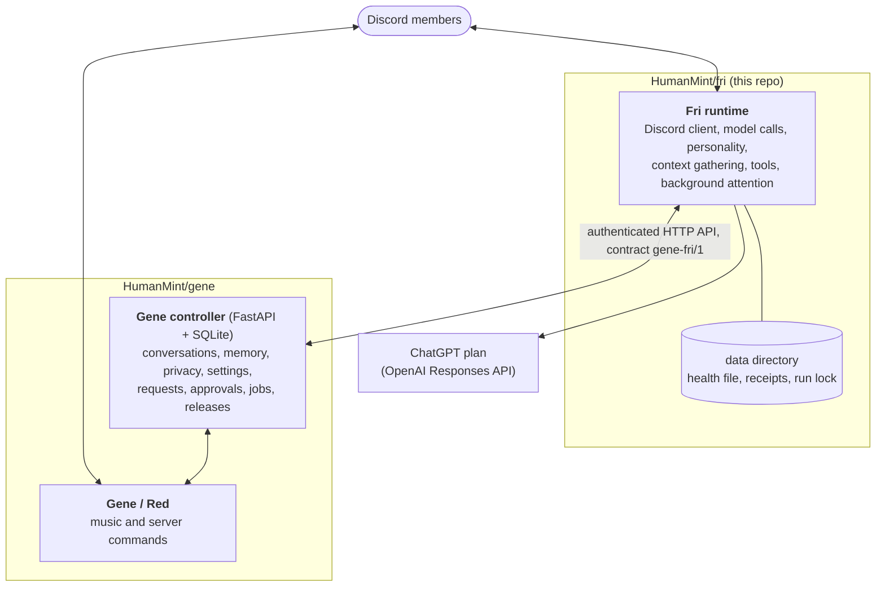

# How Fri works

Fri is split across two repositories. This one, **HumanMint/fri**, is the runtime that lives in
Discord. **[HumanMint/gene](https://github.com/HumanMint/gene)** holds the trusted controller that
stores everything durable, plus Gene's own Red-DiscordBot for music and server commands.

## Fri runtime (`src/fri/`)

A Python 3.11 package with one process per installation (`fri`, or `python -m fri.fri`).

- **Discord.** A discord.py client with the guild, guild-message, DM and message-content intents only.
  It keeps no message cache, so edits and deletes arrive as raw events, and it checks access afresh
  instead of trusting a member cache.
- **A turn.** A message that names Fri ("fri"), mentions them, replies to them or follows up shortly
  after is gathered into a burst (1.5 s, or 8 s after a bare "fri"). The controller admits it
  (configured channel, allowance, privacy revision). Fri then builds the context: its live view of the
  channel (the last 15 minutes, at most 30 messages), saved turns and notes from the controller, the
  replied-to post, linked posts and images. The model answers or calls one of Fri's tools, up to four
  steps (`fri_runner.py`); tools return typed evidence, never more authority. Before sending, Fri
  checks access, privacy revisions and edits or deletes again. Only after Discord accepts the reply
  is the turn saved to the controller, with the members whose messages shaped it.
- **Background.** A 30-second heartbeat reads the controller's state, then runs each enabled stage on
  its own: status, scheduled posts and reminders, owner reports, learning, ambient attention, Gene
  fixes, meme reactions, reply checks and member summaries. A separate watch tells the owner once per
  outage when Gene or the controller is down.
- **Model access.** `fri_chat.Chat` calls the Responses API with a Sign in with ChatGPT plan token
  (`subscription.py` renews and rotates it under a file lock). There is no API-key path. The models are
  controller settings: `gpt-6.1-sol` at high effort for conversation, `gpt-6-luna` for background
  work.
- **Voice.** `VOICE` and `INSTRUCTIONS` in `fri_chat.py` define the persona: casual, lowercase,
  deadpan, sassy; earnest and result-first when someone is working on a project; serious when the
  moment is. The owner can add voice notes as a controller setting, through a preview and Apply.
- **No database.** The data directory (`FRI_DATA`) holds only the health file, receipts waiting to
  reach the controller, small status, meme and watch state, and the lock that keeps a second process
  off the same directory.

See the [README's layout table](../README.md#whats-where) for which module does what.

## Gene controller (HumanMint/gene)

A FastAPI service with SQLite. It is the authority for everything Fri may remember or do:

- conversations (a short window of recent turns), notes, member profiles and summaries, each tied to
  a member's privacy revision, so "forget me" and memory opt-outs erase what depends on them;
- behavior settings, versioned, changed only by the owner through a preview and Apply;
- the configured server, owner and channels, which scope every Fri call;
- member requests, owner approvals, Gene's command queue, usage receipts, jobs and releases.

Fri authenticates with its own bearer token (`GENE_FRI_TOKEN`), one of four distinct service
credentials; the controller accepts it only on Fri's routes. Gene's Red bot, worker and deployer
have their own. Gene is the only deployment authority.

## The contract

The wire contract is `gene-fri/1` ([`fri_protocol.py`](../src/fri/fri_protocol.py)):

- Every request carries `X-Fri-Contract: gene-fri/1`; the controller answers another version with 409.
- At startup Fri reads `/fri/contract` and refuses to start unless the controller speaks `gene-fri/1`,
  names itself the deployment authority and offers every required capability. While the controller
  is unreachable, Fri waits and retries; a refusal stops it at once.
- Optional capabilities (member profiles, reply checks, usage windows and others) switch on features
  only when the controller offers them, so an older controller still runs a newer Fri.

Contract changes land in Gene first. A Fri change that needs them pins the Gene commit in
[`integration-pair.json`](integration-pair.json); see [contributing.md](contributing.md).

## Trust boundaries

- Fri has no shell, SSH, Docker socket, GitHub or deployment credential. A message never grants any.
- Discord content, including imported history, is untrusted evidence: never instructions, never
  approval.
- Fri reaches Gene's commands only through a small audited catalog ([`gene_controls.py`](../src/fri/gene_controls.py)):
  music playback and status reads, with Red's normal member, voice and DJ checks.
- Owner-only actions, such as settings changes and approvals, go through previews and buttons that
  the controller checks again.
- DMs stay private. Context from other members keeps its author and privacy revision, and a change
  while Fri is replying withholds the reply instead of relabeling it.

[operations.md](operations.md) describes each behavior and fence in detail.
